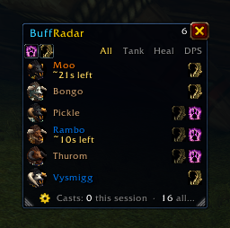

<p align="center"></p>

# BuffRadar

[](https://github.com/SeanShaffer88/BuffRadar/actions/workflows/ci.yml)

BuffRadar shows which nearby players need a buff you can cast in WoW: Forever
(Interface 16001). Click a name, press your **Cast next buff** key, or use a macro
to work through the list. By default, BuffRadar checks your own character first.

## Download and Install

1. Download the Forever ZIP from the [latest GitHub release](https://github.com/SeanShaffer88/BuffRadar/releases/latest)
   or the [CurseForge project](https://www.curseforge.com/wow/addons/buffradar).
2. Extract the `BuffRadar` folder into your Forever client's `Interface/AddOns`
   folder. The installed TOC should be at `Interface/AddOns/BuffRadar/BuffRadar.toc`.
3. Enable BuffRadar in the game's AddOns list.

## Quick Start

- Run `/br config` to open settings or `/br key` to bind **Cast next buff**.
  Run `/br macro` outside combat to create the BuffRadar macro.
- Open **Class & Role Assignments** with `/br buffassign`. Preview your group
  with `/br buffassign preview` or check why one player appears with
  `/br why <name>`.
- Check subgroup buff coverage with `/br coverage`. Use `/br subgroup` to list
  responsibilities and `/br subgroup FORTITUDE 1,2` to assign Fortitude to
  subgroups 1 and 2.
- Run `/br prep` to review missing or expiring buffs, consumables, and
  estimated reagent needs.
- Run `/br practice` to try editing a rule on a sample roster. Use `/br undo` to
  restore the last eligible blocker edit in your current session.

## Caster Coordination

Open the panel from **Class & Role Assignments** or run `/br coordinate panel`.
Enable cast sync and opt in for your current group. Leaders and assistants can
request reports, review a draft, publish duties, and track acknowledgements.
Casters can review, accept, or decline their duties. The panel clears stale
plans when the roster or leadership changes. `/br coordinate` lists the
available slash commands.

## Player Guides

Find supported buffs, settings, and commands in the
[Forever Player Guide](editions/forever/README.md). Review release details in
the [Changelog](editions/forever/CHANGELOG.md).

BuffRadar has targeted Forever since 1.8.0. The last Retail release was
1.7.0. See the [Retail Guide](BuffRadar/README.md) and
[Support Decision](docs/DECISIONS.md#2026-10-25--retail-support-dropped-forever-only-from-180-sean).

## Screenshots

**BuffRadar list**



**BuffRadar settings**


## Source and Contributions

- [Runtime](BuffRadar/BuffRadar.lua), [settings](BuffRadar/Config.lua),
  [slash commands](BuffRadar/Slash.lua), [profiles](BuffRadar/Profiles.lua), and
  [translations](BuffRadar/Locales).
- [Report a bug or request a feature](https://github.com/SeanShaffer88/BuffRadar/issues/new/choose).
  Use the [security policy](SECURITY.md) for private reports.
- [Contributing](CONTRIBUTING.md) and [local checks](tools/README.md).

## Repository Layout

| Path | What it is |
|---|---|
| `BuffRadar/` | Shared addon source, translations, art, bindings, and historical Retail files |
| `editions/forever/` | The Forever edition's `.toc`, README and changelog |
| `build.ps1` | Packages the supported Forever edition and SHA-256 checksum with PowerShell 7 |
| `tools/` | Automated checks — see [tools/README.md](tools/README.md) |
| `.luacheckrc` | luacheck settings used by the checks |
| `AGENTS.md` | Project rule sheet (prompt in force, frozen foundation, gate) |
| `QUALITY.md` | Quality scorecard, scored from evidence |
| `docs/` | `PARITY.md` (capability matrix) and `DECISIONS.md` (decision log) |
| `SECURITY.md` | How to report a security problem, privately |

## Making a Release

```powershell
.\tools\check.ps1 -Setup   # first time only
.\tools\check.ps1          # luacheck, Lua 5.1 compile and limits, translations, trial run
.\build.ps1                # Forever ZIP and SHA256SUMS.txt in dist\
```

Then test the Forever zip in the game. The zip holds a `BuffRadar` folder that goes in
`Interface\AddOns`.

## License

Copyright © 2026 Malikor. BuffRadar is free software under the GNU General Public
License, version 3 or (at your option) any later version — see [LICENSE](LICENSE).
