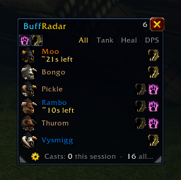

<p align="center"></p>

# BuffRadar

[](https://github.com/SeanShaffer88/BuffRadar/actions/workflows/ci.yml)

A click-to-buff list for World of Warcraft: a small window listing every nearby
player who is missing one of *your* buffs. Click a name, press one key or use one
macro to buff them. You always come first.

**From 1.8.0 (2026-10-25) BuffRadar is Forever-only** — SEAN dropped
Retail support; 1.7.0 is the last Retail release. Both editions were
built from the same source:

| Edition | Client | Interface | Status |
|---|---|---|---|
| **Forever** | World of Warcraft Forever | 16001 | [Current release](https://github.com/SeanShaffer88/BuffRadar/releases/latest) |
| **Retail** | World of Warcraft (Midnight, patch 12.1.5) | 120105 | Ended at 1.7.0 |

BuffRadar picks the right buff set when it loads. The full player guide — features,
supported buffs, commands — is in [editions/forever/README.md](editions/forever/README.md);
what changed is in [editions/forever/CHANGELOG.md](editions/forever/CHANGELOG.md).
(The Retail guide stays at [BuffRadar/README.md](BuffRadar/README.md), frozen at 1.7.0.)

Forever is the target for active development, packaging, and in-game release
testing. Historical Retail releases remain available. See the
[support decision](docs/DECISIONS.md#2026-10-25--retail-support-dropped-forever-only-from-180-sean).

## Source and contributions

- [Runtime](BuffRadar/BuffRadar.lua), [settings](BuffRadar/Config.lua),
  [slash commands](BuffRadar/Slash.lua), [profiles](BuffRadar/Profiles.lua), and
  [translations](BuffRadar/Locales).
- [Report a bug or request a feature](https://github.com/SeanShaffer88/BuffRadar/issues/new/choose).
  Use the [security policy](SECURITY.md) for private reports.
- [Contributing](CONTRIBUTING.md) and [local checks](tools/README.md).

## TL;DR

BuffRadar is a World of Warcraft addon that keeps a small list on your screen
of everyone nearby who still needs one of your buffs — like a to-do list that
ticks people off as you buff them. Click a name to cast. It is now a
Forever-only addon (the Retail edition ended at 1.7.0). It is free, works
inside the game, and uses WoW's own messaging for group coordination.

## Screenshots

**BuffRadar list**



**BuffRadar settings**


## Layout

| Path | What it is |
|---|---|
| `BuffRadar/` | The addon: `BuffRadar.lua`, `Locales/`, `Media/`, `Bindings.xml`, plus the Retail edition's `.toc`, README and changelog |
| `editions/forever/` | The Forever edition's `.toc`, README and changelog |
| `build.ps1` | Builds `dist/BuffRadar-<version>-Retail.zip` and `-Forever.zip` |
| `tools/` | Automated checks — see [tools/README.md](tools/README.md) |
| `.luacheckrc` | luacheck settings used by the checks |
| `AGENTS.md` | Project rule sheet (prompt in force, frozen foundation, gate) |
| `QUALITY.md` | Quality scorecard, scored from evidence |
| `docs/` | `PARITY.md` (capability matrix) and `DECISIONS.md` (decision log) |
| `SECURITY.md` | How to report a security problem, privately |

## Making a release

```powershell
.\tools\check.ps1 -Setup   # first time only
.\tools\check.ps1          # luacheck, Lua 5.1 compile and limits, translations, trial run
.\build.ps1                # both zips into dist\ (only the Forever zip ships, from 1.8.0)
```

Then test the Forever zip in the game. The zip holds a `BuffRadar` folder that goes in
`Interface\AddOns`.

## License

Copyright © 2026 Malikor. BuffRadar is free software under the GNU General Public
License, version 3 or (at your option) any later version — see [LICENSE](LICENSE).
