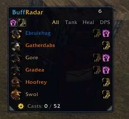
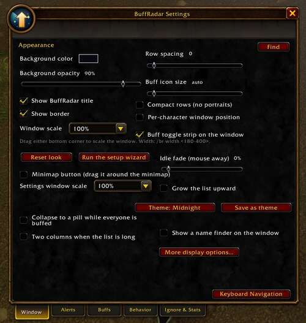
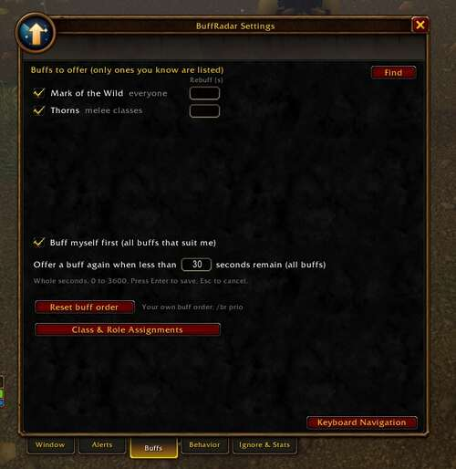
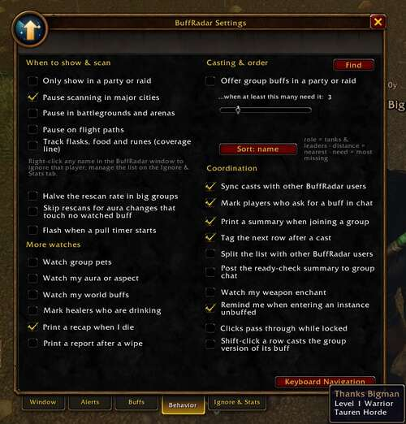

# BuffRadar

**A click-to-buff list for World of Warcraft Forever.**

BuffRadar shows a small window listing every nearby player who is missing one of *your*
buffs — with their portrait, class-colored name and icons of what they still need.
Click a name to buff them. Press one key (or one macro) to buff the next person.
Your character comes first by default.

## Current Forever Workflow

### Find Settings and Actions

Choose **Actions** in Settings or enter `/br actions`. Search by a feature name,
purpose, or slash command. All, Settings, and Actions filters share the same
paged results, keyboard navigation, and narration. Unavailable actions remain
readable and explain what prevents opening them.

Inspect preparation, coverage, group eligibility, and peers; open assignment,
subgroup, profile, recent-change, or theme screens; or copy a Support report and
run diagnostics. **Why This Buff?** accepts a player name. Existing editors and
confirmation steps still govern changes. Nothing casts or posts automatically.
Shift-left-click the gear or assign the optional Actions keybind to open the
same menu. Other gear clicks and slash commands keep their existing behavior.

### Diagnose Battleground Pauses and Blessing Choices

Use `/br support` to copy the private technical report. It includes instance
type, battleground pause preference, current blocker, player combat/PvP state,
and detected blessing families from the current spell cache. Missing evidence
is marked unknown; the report excludes player and caster names and raw errors.

Use `/br why NAME` with a visible friendly player to explain the current pause
separately from that player's buff needs. For Paladins it distinguishes all
detected blessings from the preferred and effective choice, then explains
assignment/plan/preference precedence and blessing complement decisions.
Complement applies to nearby players outside your group; unreadable ownership
cannot establish a safe alternative. Class defaults alone do not show every
detected blessing.

For a battleground report, capture the output while alive and out of combat and
check **Pause in battlegrounds and arenas**. For a blessing report, also capture
the learned spell ranks and **Blessings by Class** choices. These diagnostics
observe current rules; changing a pause or assignment still requires your action.

### Coverage Views and Confirmed Restocking

Open `/br matrix` for a paged, read-only player-by-buff grid, or toggle
`/br selfstrip` for stable personal buff status slots. Both use completed scan
observations and label unavailable, unknown and stale readings. They do not
cast, and the existing header icons continue to control tracking separately.
Optional panel positions follow **Remember Settings and Ready Check positions**.

Open `/br supplies` and opt in to restock previews. Set supported reagent item
IDs, target quantities, a copper spending cap and an item cap. Targets start
empty; a quantity of 0 removes one. **Refresh Preview** at a merchant shows the
exact proposed units and cost. **Confirm Next Purchase** buys only the next
quoted reagent row; refresh and review again for another purchase. Caps apply
to each confirmation. Nothing purchases automatically, and requested purchases
are reported as pending until the player checks their bags.

The adapter rejects unknown prices/counts, unsupported tuple shapes, alternative
currencies and changed quotes. It rounds quantities down to merchant bundles
and uses empty general bag slots conservatively. Combat, merchant closure or
inventory/money updates invalidate confirmation. Live client behavior remains
**Unverified**; offline mock checks cannot establish merchant API behavior.

1. **Set up discovery.** Run `/br wizard` to review a starting setup and
   `/br plates` for readable friendly nameplates outside your group.
   Group, target and mouseover checks also contribute. `/br nearby` explains
   discovery; `/br plates restore` undoes recorded nameplate changes.
2. **Choose cast delivery.** Bind **Cast next buff** through `/br key` or
   `/br gamepad`, click a player row, or create the managed action-bar macro
   with `/br macro` outside combat. Hover the footer for separate binding
   and macro readiness. A queue entry can exist while the macro is parked.
   Follow the displayed reason; use the direct binding only when it is ready.
3. **Find and adjust settings.** `/br config find` searches **Window**,
   **Alerts**, **Buffs**, **Behavior**, **Ignore & Stats**, and **Readiness**.
   Results show `Tab > Setting`; select one to open and focus its control
   without changing the value. Previous/Next pages through matches. Tab and
   Enter navigate results, and Escape closes search. Use `/br config narrate`
   for the game's configured speech support.
4. **Buff and prepare.** Review the next-cast preview, then activate a cast.
   `/br why <name>` explains eligibility or assignments. `/br coverage` and
   `/br prep` distinguish confirmed, missing and unknown observations.
   Unreadable aura data is unknown. Assignment rules use the class's World
   cell when a recipient's group role is unavailable, then normal inheritance.
5. **Keep and share settings.** Use **Ignore & Stats** or `/br profile` for
   named profiles and their import preview. Loading a profile is separate
   from importing it. `/br status export` copies local diagnostics, including
   **Cast delivery**. See [Features](FEATURES.md) for the full reference and
   [Changelog](CHANGELOG.md) for historical changes.

Recipient-level rank selection is available in supported cast modes when the
client supplies learned-rank and recipient-level data. Plain-name macro mode
lets the game choose the rank. Missing information can leave the highest
learned rank as the fallback; the preview shows the prepared cast.

For a first cast, `/br firstcast` explains discovery and separate direct/macro
readiness, then waits for a cast you activate yourself. Closing starts no work;
reopening begins a new attempt. Combat pauses guidance and keyboard capture.
`/br support` opens a copyable local technical report without player names,
profile labels, histories, macro bodies or raw errors. It sends nothing. Both
commands also have **Readiness** settings buttons. All five translated packs
(German, French, Spanish, Russian and Simplified Chinese) cover every current
interface key; offline format and flow checks are separate from native-speaker
and in-game rendering validation.

## Screenshots

Captured in WoW: Forever with BuffRadar v1.15.35.

**BuffRadar list**

Settings tabs

### Window

### Alerts

### Buffs

### Behavior

### Ignore & Stats

## TL;DR

Think of it as a to-do list for buffing: BuffRadar watches your group and
shows you exactly who still needs one of your buffs — Fortitude, Kings,
whatever your class brings — with a picture of what they're missing. Click
their name and the buff is cast, at the right rank, single or group version
as the situation calls for. When everyone is buffed, the list empties and
gets out of your way. It costs nothing, asks for nothing, and never talks to
anything outside the game.

Version 1.18.0 · Interface 16001 · GPLv3.
Field-tested through v1.15.33; v1.15.34 and later remain Unverified in game.

**Forever-only from 1.8.0:** the Retail edition ended at 1.7.0 (dropped
2026-10-25). Both editions were built from the same source; this zip's `.toc`
targets the Forever client, and BuffRadar picks the Forever buff set when it loads.

---

**Docs:** [Features](FEATURES.md) · [Description](DESCRIPTION.md) · [Changelog](CHANGELOG.md)

## Upgrading to 1.18.0

Back up `BuffRadarDB`'s SavedVariables file before upgrading. Existing valid
settings upgrade to schema 23. A newer schema is left untouched; your
changes in this session don't save. The same temporary mode applies if an
older save has more than 32 profiles or 192 permanent ignores (or a profile
body over 4,000 bytes). After backing up or exporting what you want to keep,
use `/br storage delete profile <name>` or `/br storage delete ignore <name>`
to remove an entry from an over-limit save, then reload. Those commands
can't edit a newer-schema save.

`/br selftest` should report **1.18.0 · Forever edition · interface 16001**.
An incompatible client won't start the cast UI or change your saved settings.

Coverage Matrix, Self Buff Status and reagent restocking start disabled.
Restocking also starts with no targets and requires a reviewed merchant quote
and an explicit confirmation for each purchase. Daily Tasks offers the common
workflow; the existing expert settings remain available.

Sharing defaults to preferences without player identities. The recipient keeps
their ignored players and named exceptions; choose the full-backup scope only
when those identities should be included. Recent Changes can undo ordinary
preferences from this session, but never purchases, identities or network actions.

## Reviewed assignments, imports and recovery

In the assignment picker, **Copy Cell…** or **Copy Row…** stages the configured
rules for an explicit destination. Review the changed rules and current-group
offers before applying. Default, None and custom selections remain distinct;
Normal assignment-picker edits take effect immediately; Done, X and Escape
retain the selection and return to the grid. In a blocker draft, Cancel, X and
Escape discard staged edits; review Back returns to the staged editor.

Import review defaults to **Whole Profile**, preserving the complete import.
Choose **Selected Sections** to apply only Appearance, Alerts and/or Buff Rules.
Partial imports leave identities, connections, supplies and unselected settings
unchanged; the complete input is still validated before review.

`/br recovery` previews one bounded local preference restore point before an
explicit restore. It is not a file backup and excludes player identities,
profiles, cast history and purchase authorization. Existing unmarked settings
can provide a snapshot of previous preferences; a later addon upgrade replaces it
with one pre-upgrade point. Keep a separate SavedVariables backup.

`/br whatsnew` reopens the three-item update notice. Dismiss it or follow its
Daily Tasks link; dismissal is shared across characters using the account save.
Settings also provides recovery and update-notice links.

## Readiness

Open **Settings → Readiness** for these controls. Combat restrictions on
click-to-buff casts still apply.

| Command | What it does |
| --- | --- |
| `/br wizard` or `/br quicksetup` | Pick your activity and primary role, then review and apply the setup. You can also Shift-right-click the minimap button. |
| `/br forecast 60` | Warn about confirmed expiry within 60 seconds. A supported pull countdown adds to the lead time. `/br forecast timer 30` uses a local deadline; `/br forecast off` stops warnings. Forecasts don't change cast eligibility. |
| `/br smartprio on` | Promote defensive buffs for tanks and wipe recovery, and mana buffs for healers. `/br smartprio here <KEY>` gives one eligible buff priority in this instance; use `clear` to remove the rule. `/br smartprio instance <ID> <KEY>` sets a rule from outside it. Off restores manual priority. |
| `/br debuff add <spell ID> [player\|focus] [encounter ID]` | Save a watch, then use `/br debuff on` to show readable icons and stacks. Omit the unit for yourself and the encounter ID to watch anywhere. Use `/br debuff list` or `/br debuff remove <spell ID> [player\|focus]` to manage watches. |
| `/br readiness` | Open **Personal** checks, including carried Healthstones and gear durability, even when solo. `/br readiness aura <spell ID\|off>` watches a consumable aura such as an augment-rune equivalent. `/br prep` opens the group checklist. |
| `/br minimapstatus` and `/br visual on` | Toggle coverage symbols or enable brief highlights independent of sound. Visual alerts respect Reduced Motion. |
| `/br throttle on` and `/br stats memory` | Adjust the low-frequency cooldown sweep for movement, group size and latency, and see the game's reported total addon memory. Aura and roster refreshes remain event-driven. |
| `/br lite on` | Pause forecasts, preparation, debuffs, and optional watches without losing their settings. The main cast queue still works. |
| `/br status export` and `/br feedback` | Copy a local status report or the feature-request link. No player data is attached to feedback. |

The **Personal** tab checks Healthstones in bags, not in the bank. It can't
confirm a placed Soulwell. Durability shows the lowest readable gear slot
and recommends repairs at 30% or below. Forever has no assumed augment-rune
aura; enter the spell ID of an equivalent you use. See the
[status API](https://github.com/SeanShaffer88/BuffRadar/blob/main/docs/STATUS_API.md)
and [roadmap](https://github.com/SeanShaffer88/BuffRadar/blob/main/docs/ROADMAP.md).

## Features

- **Live list of who needs what.** Players stay listed until every buff you can cast
  that suits their class has been applied, then drop off.
- **The list grows downward.** The window is anchored by its top-left corner, so
  its top edge stays exactly where you put it as names come and go — only the
  bottom edge moves.
- **Scroll long lists.** The list shows up to 15 rows, fewer when your screen
  or UI scale leaves less room. Use the wheel or `/br scroll up|down`. The
  footer shows the visible row span. Cast Next Buff still uses the head of
  the full queue.
- **You first.** Your own character is always checked first and sits at the top of the
  list whenever you're missing something.
- **Class-aware.** Arcane Intellect only goes to mana users, Thorns to melee classes,
  Fear Ward to warriors, and so on. Paladins give each class one fitting blessing.
  Druids can enable **Thorns: Any Class Outdoors** on the Buffs tab to offer
  Thorns to any class in the open world. Inside instances Thorns uses the
  normal melee-class rule. Explicit assignments take precedence in both places.
  Use `/br thornsoutdoors on` or `/br thornsoutdoors off` for the same setting.
- **One-key buffing.** Bind *Cast next buff* or use the BuffRadar macro to work through
  the list without clicking.
- **Recipient rank.** When Forever provides the recipient's level and spell
  rank information, BuffRadar can select a rank the recipient can receive.
  Hover over the window footer to preview the spell prepared for the next player.
- **Smart checks.** Group versions (Arcane Brilliance, Prayer of Fortitude, Gift of the
  Wild, Greater Blessings) count as "already buffed". Buffs about to expire are offered
  again. Spells on cooldown are skipped.
- **Water droplet alert** when someone new appears (optional, with a mute keybind;
  a system sound or silence can be chosen instead, and alerts can stay quiet in
  instances).
- **Group-cast offers:** when enough of your party or raid needs the same buff,
  BuffRadar offers the group version (Prayer of Fortitude, Gift of the Wild…)
  instead. It falls back to the single-target spell when group range,
  recipient eligibility, cooldown or required reagents block the group
  version. Supported pets get single-target buffs only. Ready Check estimates
  reagent needs.
- **Only eligible players appear:** your character must know a useful buff, and
  both characters must be out of combat. An explicitly out-of-range player
  stays off the cast list. When spell range cannot be checked, BuffRadar may
  use readable proximity information. `/br assumerange` opts into estimated
  range for otherwise eligible single-target offers. **Right-click a row**
  to ignore a player who doesn't want buffs.
- **Paladin blessings by class:** choose a known blessing for each class from
  the Buffs tab, or use `/br bless prefer <CLASS> <BLESSING|DEFAULT>`. An active
  group blessing plan takes precedence. Use
  `/br bless player <target|name> <BLESSING|DEFAULT>` to set or clear a
  normal blessing exception for a member of your current group.
  **Complement Nearby Blessings** is on by default; use its checkbox or
  `/br bless complement off` to disable it. It picks a different known
  class-appropriate blessing when an ungrouped player already has your
  preferred blessing from another Paladin, including its Greater version.
  It does not override group plans or explicit class/role assignments.
- **Class & Role Assignments** (optional): from Settings → Buffs, open
  **Class & Role Assignments** or type `/br buffassign`. A known group role
  uses its class and role cell. Strangers and players whose role is
  unavailable use the class's World cell. An unset cell falls back to All,
  then to the normal rules. Choose **None** to skip managed targeted buffs
  for a cell, or **Default** to restore inheritance. Named profiles save the
  table and its on/off setting. Use named profile sharing to transfer these
  rules. The legacy `/br export` format omits the table. If a group version
  would conflict with another member's assignment, BuffRadar offers a
  single-target cast. The assignment preview lists the known blocking
  players and their rules. The next-cast tooltip shows the count.
  Both indicate when roster information is incomplete. Use **Edit Rule**
  on a blocker to open its exact assignment cell or local blessing
  exception. Use **Review Changes** to see who would gain or lose a buff
  offer. **Apply** rechecks the current group before saving and refreshes
  the blocker list.
- **Preview Current Group** in Class & Role Assignments shows the effective
  rule and buff information for each group member. Open it with
  `/br buffassign preview` or check one player with `/br why <name>`.
  The open preview updates when the roster or roles change. Use
  **Refresh Preview** to check current buffs and reagents.
  When a group member's role is unavailable, select their row to set or
  clear a role for assignment rules. A role reported by the game takes
  precedence. Overrides clear when the member leaves or the UI reloads.
- **Raid Coverage** in Class & Role Assignments or `/br coverage` shows
  confirmed, missing, and unknown readings for the buffs you offer in each
  subgroup. Select a buff to see the players with missing or unknown coverage.
- **Practice Mode** (`/br practice`) walks through a sample blocker edit.
  **Undo Last Change** (`/br undo`) restores the last blocker edit in this
  session while the target rule, profile, and applicable roster still match.
- **Subgroup Responsibilities** limits each buff's raid cast queue to selected
  groups. Open it from **Raid Coverage** or run `/br subgroup panel`. Pick a
  buff, select groups 1–8, and check the roster and any single-target fallback
  reasons before applying. The existing `/br subgroup FORTITUDE 1,2` command
  edits the same selection. Use `/br subgroup` to list keys and selections, or
  `ALL` to clear a filter. These rules clear when you leave the raid or reload.
- Open the read-only **Raid Preparation** checklist from **Raid Coverage** or
  with `/br prep`. Expand a player to see missing and expiring buffs, food,
  flasks, and unavailable readings. The **Reagents** tab compares bag counts
  with estimated group requirements and highlights shortfalls. The checklist
  refreshes when the roster changes. Use **Refresh Preparation** to recheck
  buffs and bags, or `/br prep personal` to include weapon and pet reminders.
- **Caster Coordination** is available in Class & Role Assignments or
  through `/br coordinate panel`. Turn on cast sync, then join coordination
  for the current group. Leaders and assistants can request reports, review
  draft duties, publish them, and check acknowledgements. Casters can review
  and respond to incoming plans. Roster or leadership changes clear stale plans.
  To use slash commands, opt in with `/br coordinate on`. Leaders and
  assistants can `request` reports, add buff keys with `need`, then
  `review` and `publish` a plan.
  Recipients review it with `inbox` and choose `accept` or `decline`.
  The coordinator's `status` shows acknowledgements separately from coverage.
- **Window themes** include built-in palettes, custom colors, and opt-in
  automatic matching. Select **Auto** using the Theme button or
  `/br theme ui.auto`. Open **Auto Theme Priority** on the Window tab or run
  `/br theme priority panel` to reorder eligible matches and see the selected
  addon.
- **Role ordering** option: you, tanks and leaders first.
- **Rezzed players first** (after you): someone who just came back from the dead
  has lost every buff, so their row jumps up with a *recently rezzed* marker.
- **Row markers:** *a buff just expired* when a buff vanishes outright, and
  *~4m left* on a buff inside its rebuff window.
- **Coverage line** while grouped: how many members are fully buffed, and
  per-buff coverage — also your progress while buffing a fresh group.
- **Session-only ignore:** Shift-right-click a row to ignore someone until
  you log out (nothing saved).
- **`/br announce`** requests a party/raid post and prints a local report on
  refusal. A submitted send is not proof of delivery. Ready checks give a
  local summary; `/br ready show` displays individual responses and buff status.
- **Low-mana pause** (optional): listing pauses while your mana is under a
  percentage you set.
- **Distance ordering** option: nearest first.
- **Settings and profile imports:** `/br import` reviews a BR1 copy before
  applying settings locally. `/br profile import` lets you rename or replace
  a saved profile without loading it. `/br plan import` reviews assignments,
  blessings and auto-profile mappings before merging. Choose **Apply locally**
  to send nothing, or **Apply and share** when offered to send only assignment
  and blessing changes to the current group.
- **Compact rows** without portraits, a separate list text size, and a
  per-character window position option. `/br positions on` remembers where
  you drag Settings and Ready Check; `/br positions off` or `reset` clears
  those panel positions.
- **Post-combat flash:** the border pulses once when combat ends with
  buffs still missing.
- **Cast sync between BuffRadar users:** when anyone running BuffRadar in
  your group casts a buff, everyone's list marks that player *being buffed*
  for a few seconds — no more double-casting the same buff.
- **Chat requests and join digest:** a listed player who asks for a buff
  in a whisper or nearby say gets an *asked for a buff* marker, and
  joining a group prints a one-line summary of who still needs what.
- **Toggle strip:** a bar under the title carries one icon per buff you
  can cast (click to toggle it). The role filter chips beside it need
  assigned group roles, which this client doesn't expose, so they have
  no effect here.
- **Need ordering** option: whoever is missing the most buffs comes first.
- **Named settings profiles:** save complete settings sets under a name
  and load them on any character (`/br profile`).
- **Drop alert:** when your Earth Shield drops off its holder, you get a
  message, the alert sound and a border flash.
- **Coverage honesty:** a buff on a real cooldown is flagged on the
  coverage line — *Fortitude 15/15 (~3m cd)* — since it can't be counted
  as missing while it cools down.
- **Idle fade and flight-path pause:** the window can fade while your
  mouse is elsewhere, and (optionally) pause while you're on a flight
  path. A saved window position that would land off-screen is rescued
  instead of restored blind.
- **Blessing planner:** plan which blessing each class gets
  (`/br bless WARRIOR KINGS`) — your casts follow the plan, and other
  paladins running BuffRadar see it on their rows; one named paladin
  can own a class.
- **Buff assignments:** the leader can assign a buff to one player —
  their rows float (*your assignment*), everyone else's sink
  (*assigned elsewhere*).
- **Buddy split:** two or more BuffRadar users in a group can split the
  list between them by a stable hash; your share floats, the rest sink.
- **Cover-me handoff:** when a BuffRadar user dies or goes AFK, their
  duties pass to the others automatically (sync channel, no setting).
- **Pin, weapon watch, cast history:** keep one player on top
  (`/br pin`), check applicable melee weapons for temporary coatings, and
  review your last 50 casts (`/br history`).
- **All-buffed pill:** when everyone is fully buffed the window
  collapses to a small pill with the coverage count; click to peek.
- **Cast queue tag:** the next row is tagged *up next* for a few
  seconds after one of your casts lands.
- **Consumables watch:** the coverage line counts recognised flask and food
  auras (read-only — no rows). An unreadable aura check is unknown, not missing.
- **Custom watched spells:** watch any buff spell you know
  (`/br custom add <spell ID>`), offered to everyone it suits.
- **Coverage uptime:** the share of grouped scans this session that
  found nobody missing anything, on the coverage line and via
  `/br uptime`.
- **Presets and auto profiles:** one-click Raid / Dungeon / Solo
  presets (`/br preset`), and named profiles that load themselves by
  context — raid, dungeon, battleground, grouped world, solo
  (`/br autoprofile`).
- **Stays out of the way:** pauses in major cities (and, optionally, in
  battlegrounds), can show only while you're in a party or raid, and has a
  show/hide keybind, a minimap button and an addon-compartment entry.
- **Cast counter** for this session and all-time, plus per-spell cast statistics.
- **Customizable look:** background color, opacity, title, border, width and scale —
  in the six-tab settings window (Window / Alerts / Buffs / Behavior / Ignore & Stats / Readiness).
  Drag either bottom corner to scale the whole window (or set the width with `/br width`); pick a scale
  (50%–200%) for the list window and for the settings window from their dropdowns.

## Supported buffs

| Class   | On by default | Off by default (situational) |
|---------|---------------|------------------------------|
| Druid   | Mark of the Wild (everyone), Thorns (melee) | — |
| Priest  | Power Word: Fortitude (everyone), Divine Spirit (mana users), Fear Ward (warriors), Inner Fire (you), Shadowguard (you) | Shadow Protection |
| Mage    | Arcane Intellect (mana users), Molten / Mage / Ice / Frost Armor (you) | Dampen Magic, Amplify Magic |
| Paladin | One blessing per class: Kings for everyone if you know it; otherwise Might for warriors and rogues, Wisdom for everyone else | — |
| Warlock | Fel / Demon Armor or Demon Skin (you) | Unending Breath, Detect Invisibility |
| Shaman  | Water or Lightning Shield (you) | Earth Shield, Water Breathing |

Warriors, rogues and hunters have no buffs for others, so the window stays hidden on
those characters.

## Installation

BuffRadar hides its list, pill, settings and minimap button while your
character is dead or a ghost. Casting resumes after you return to life and
leave combat. Your saved visibility preferences still apply. Hover the buff
window to reveal its close button. Turning off the title also removes the
header space above the list.

1. Download and unzip.
2. Move the `BuffRadar` folder into your Forever `Interface\AddOns` folder, so the path
   is `Interface\AddOns\BuffRadar\BuffRadar.toc`.
3. Restart the game (a `/reload` is not enough the first time).
4. **Turn on friendly nameplates** (Shift+V, or `/br plates`). The game only lets addons
   see nearby players outside your group through their nameplates.

## Using it

| Action | How |
|---|---|
| Buff someone | Click their name in the window |
| Buff the next person | Your *Cast next buff* key, or the BuffRadar macro |
| Settings | Gear icon in the bottom-left corner, right-click the minimap button or the addon menu entry, Esc > Options > AddOns > BuffRadar (on clients that list addon options), or `/br config` — hover any setting for a short explanation |
| Show / hide from the minimap | Left-click the minimap button or BuffRadar in the minimap's addon menu |
| Rebuff timing | Settings > Buffs: a seconds box per buff (empty = the all-buffs time) and one for all buffs |
| Move the window | Drag it (lock it with `/br lock`) |
| Resize the window | Drag either bottom corner (scales window, rows and text), or pick a scale in Settings > Window; `/br width <180-400>` sets the width |
| Hide or show the window | Your *Show / hide window* key, or `/br` |
| Mute the sound | Your *Mute / unmute sound* key, or `/br sound` |

Use **Keyboard Navigation** in the settings footer or `/br config navigate` outside combat. **Tab** and **Shift+Tab** move between tabs and visible controls. **Enter** or **Space** activates the focused control, and arrow keys adjust sliders and choices. In a text field, **Enter** returns to navigation after editing, **Tab** advances, and **Escape** ends editing using that field's usual cancel behavior. **Escape** from navigation exits the mode. Use `/br config narrate` to start with speech, or **F1** to toggle it while navigating. Narration uses the installed game voice and its rate and volume. The color picker, keybind prompt, setup wizard, and profile share dialog use their own controls.

Hover over a name to see exactly what will be cast and what they still need.

### Keybind and macro

- **Keybinds:** `/br key` opens the game's **Key Bindings → BuffRadar**. Bind
  **Cast next buff** to a key or controller button. There are also bindings for
  **Cast next group buff**, **Show / hide window**, and **Mute / unmute sound**.
- **Macro:** Settings > *Create macro* (or `/br macro`) puts the managed
  **BuffRadar** macro on your cursor. Drop it on an action bar and activate
  the slot with your keyboard, controller, or mouse. The macro follows the
  queue; don't copy its body into a custom macro. Existing auto-generated
  macros update in place. A hand-written `/click BuffRadarNextButton` macro
  cannot execute another macro, so replace it with the managed one. Use the
  direct binding if the footer reports it ready while the action-bar macro
  exceeds the game's 255-byte limit. Both paths can be unavailable for an
  unsafe cast. Pending synchronization can mean the macro editor is open,
  a macro is running, or combat prevents an update. Hand-edited macros stay
  untouched. Remove the bar macro if you disable or uninstall BuffRadar.
- **Controllers:** `/br gamepad` opens the same binding menu and shows the two
  ways to set up controller buffing. To put the macro on a gamepad action bar
  without a mouse, select **BuffRadar** in the game's Macros window and use
  the prompt to bind it to a gamepad action bar. Neither method needs the
  cursor over a player row when casting.

If only your own character appears, run `/br nearby` to check discovery. Test
outside a capital, or turn off the default city pause with `/br cities`.

## Commands

| Command | What it does |
|---|---|
| `/br` | Show or hide the window |
| `/br config` | Open the settings window |
| `/br config navigate` | Open settings in keyboard navigation mode |
| `/br config narrate` | Open keyboard navigation with the game's text-to-speech voice |
| `/br key` · `/br gamepad` | Open the BuffRadar key bindings for a keyboard or controller |
| `/br macro` | Create the BuffRadar macro |
| `/br buffs` | List the buffs you can cast and whether each is on |
| `/br toggle KEY` | Turn one buff on or off (keys come from `/br buffs`) |
| `/br self` | Turn checking yourself first on or off |
| `/br sound` | Turn the water droplet alert on or off |
| `/br group` | Only show the window in a party or raid (off by default) |
| `/br cities` | Pause scanning in major cities (on by default) |
| `/br count` · `/br resetcount` | Show or reset the cast counter |
| `/br rebuff <seconds>` · `/br rebuff KEY <seconds>` | Re-offer a buff when less than this much time is left (default 30; per-buff override by key; also on Settings > Buffs) |
| `/br groupcast [on\|off\|<n>]` | Offer group buff versions when n+ group members need the same buff |
| `/br sort name\|role\|distance\|need` | List order: name, tanks & leaders first, nearest first, or most missing first |
| `/br ignore <name>` · `/br unignore <name>` · `/br ignorelist` | Manage the ignore list (or right-click a row; remove names on the Ignore & Stats tab). Capitals don't matter; `Name-Realm` means that one player, a plain `Name` means that name on every realm |
| `/br alertsound droplet\|system\|none` | Choose the new-name alert sound |
| `/br announce` | Post the group's missing buffs to party/raid chat |
| `/br sync` · `/br requests` · `/br digest` | Cast sync between BuffRadar users · chat-request markers · join summary |
| `/br filter all\|tank\|healer\|dps` | Narrow the window list to one role (needs assigned roles; no effect on this client) |
| `/br strip` · `/br fade <0-90>` | Buff toggle strip on the window · idle fade while the mouse is away |
| `/br profile save\|load\|delete\|list <name>` | Named settings profiles |
| `/br watch` · `/br taxi` | Alert when your single-target buff drops · pause on flight paths |
| `/br bless <CLASS> <BLESSING> [name]` | Plan which blessing each class gets |
| `/br bless complement on\|off` | Toggle alternate blessings for ungrouped players already covered by another Paladin |
| `/br bless player <target\|name> <BLESSING\|DEFAULT>` | Set or clear a normal blessing exception for a member of your current group |
| `/br ready show\|hide\|next\|prev` | Show, hide, or scroll the local ready-check detail |
| `/br assign <BUFF> <name\|none>` | Leader assigns a buff to one player (rows float/sink by owner) |
| `/br buddy` · `/br pill` | Split the list with other BuffRadar users · all-buffed pill |
| `/br pin <name\|none>` · `/br readypost` | Pin a player to the top · post ready-check summaries |
| `/br weapon` · `/br enterflash` · `/br throttle` | Weapon enchant watch · instance-entry reminder · adaptive cooldown-sweep throttle |
| `/br history` | Your last 50 casts through BuffRadar |
| `/br consumables` · `/br uptime` | Flask/food counts on the coverage line · coverage uptime % |
| `/br custom add\|remove\|list <spell ID>` | Watch any buff spell you know |
| `/br preset raid\|dungeon\|solo` · `/br autoprofile <context> <profile>` | Shipped presets · load a profile by context |
| `/br resetpos` | Reset the window position (also clears the per-character spot) |
| `/br signore <name>` · `/br unsignore <name>` | Ignore a player for this session only (or Shift-right-click a row) |
| `/br mana <0-100>` | Pause listing below this mana % (0 = off) |
| `/br export` · `/br import` | Copy settings between characters; review before applying locally |
| `/br profile import` · `/br plan import` | Review a named profile or plan before saving or applying it |
| `/br positions on\|off\|reset` | Remember or recenter Settings and Ready Check panel positions |
| `/br compact` · `/br text <0.8-1.5>` · `/br charpoint` | Half-height rows · list text size · per-character window position |
| `/br selftest` | Print a paste-able block for bug reports |
| `/br bg` · `/br minimap` · `/br stats` | Pause in battlegrounds · toggle minimap button · casts by spell |
| `/br pvp` | Include or skip PvP-flagged players when you aren't flagged (skipped by default) |
| `/br lock` · `/br scale <n>` · `/br reset` | Lock (moving and resizing), set any scale from 0.5 to 2, or reset the window's position |
| `/br autohide` | Hide the window when nobody needs anything |
| `/br plates` · `/br plates on\|off` | Enable or disable the game's friendly nameplates |
| `/br plates names\|bars` | Hide or show friendly health bars without changing discovery (on supported clients) |
| `/br plates restore` | Restore nameplate settings last changed through BuffRadar |
| `/br nearby` | Open Nearby Player Diagnostics to change friendly nameplates and check the scan and your current target |
| `/br clicks` · `/br debug` | Troubleshooting output |

## Good to know

- **Combat:** the window hides and buff buttons are disabled while your character is
  in combat; it returns when combat ends.
- **Line of sight:** addons can't reliably check it before casting. When BuffRadar
  can link a line-of-sight failure to its cast, it temporarily skips that target so the next
  keybind press can continue to the next eligible player.
- **Targeting:** party and raid members are buffed directly, without touching your
  target. To buff a player outside your group, BuffRadar targets them by name,
  casts, then switches back to your previous target.
- **Seeing strangers:** the game gives addons no list of nearby players. BuffRadar
  finds people through your group, your target, your mouseover, and friendly
  nameplates — so with friendly nameplates off, only grouped, targeted or hovered
  players can appear. When nameplates are off the window says so instead of
  claiming everyone is buffed, and BuffRadar warns once at login. `/br debug`
  shows whether nameplates are on and how many the game is currently showing.
  BuffRadar doesn't tint world nameplates. To hide their health bars while
  still finding nearby players, use `/br plates names` or **Show Friendly
  Names Only** in Nearby Player Diagnostics. Use `/br plates restore` to
  undo recorded changes, including **Always Show Nameplates** if BuffRadar
  turned it on. Changes made by older versions weren't recorded; if needed,
  use `/br plates off` and adjust **Always Show Nameplates** in game options.
- **Major cities:** Stormwind, Ironforge, Darnassus, Orgrimmar, Thunder Bluff, Undercity,
  The Exodar, Silvermoon and Shattrath. If a city isn't detected, `/br debug` shows the
  zone and map ID BuffRadar sees.
- **Cast counter:** the session count resets on login or `/reload`. The all-time count
  is shared by all your characters.
- **Languages:** German (`deDE`), French (`frFR`), Spanish (`esES`), Russian
  (`ruRU`) and Simplified Chinese (`zhCN`) packs cover current interface text,
  settings, help and review messages. Spell names and other game-provided content
  come from the client. The [locale template](../../BuffRadar/Locales/deDE.lua)
  documents translation-file conventions.

## Credits

Casting approach and buff coverage were informed by
[BuffYou](https://www.curseforge.com/wow/addons/buffyou) by datdata (MIT license).
The water droplet sound and the logo were made for BuffRadar.

## License

Copyright © 2026 Malikor.

BuffRadar is free software: you can redistribute it and/or modify it under the terms of
the GNU General Public License as published by the Free Software Foundation, either
version 3 of the License, or (at your option) any later version. See [LICENSE](LICENSE)
for the full text.
